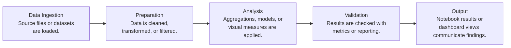

# StockDataAnalysis powerbi

Analyzes stock data in Power BI using spreadsheet inputs and interactive visuals.

## Overview

The repository contains an implemented application or analysis project with code organized around its primary runtime, interface, data, or automation responsibilities.

## Key Features

- Data ingestion and cleaning
- Structured analysis or reporting
- Interactive or notebook-based presentation
- Repeatable processing workflow

## Technology Stack

| Area | Technology |
|---|---|
| Platform | Power BI |
| Library / Framework / Tool | Spreadsheet / CSV data |

## Architecture and Data Flow

| Stage | Responsibility |
|---|---|
| **Data Ingestion** | Source files or datasets are loaded. |
| **Preparation** | Data is cleaned, transformed, or filtered. |
| **Analysis** | Aggregations, models, or visual measures are applied. |
| **Validation** | Results are checked with metrics or reporting. |
| **Output** | Notebook results or dashboard views communicate findings. |

## Repository Structure

- `stock Data Analysis(powerbi).pbix`
- `StocksData.xlsx`

## Setup

1. Open the report with Tableau or Power BI as applicable.
2. Confirm the workbook data-source paths.
3. Refresh the report and review the dashboards.

## Usage

Open the workbook, refresh the connected data, and interact with filters or dashboard views.

## Configuration

No mandatory repository-specific configuration is documented by the project structure. Environment or runtime options may be defined inside the relevant entry-point file or platform settings.

## Verification

- Refresh the report data source and verify the dashboards, filters, totals, and chart outputs.
